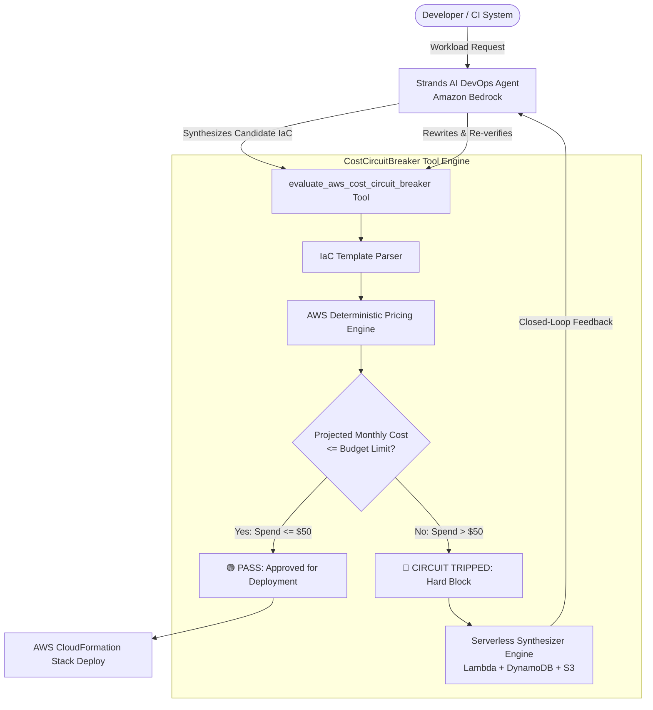

# CostCircuitBreaker ⚡

> **Autonomous FinOps Safety Tool for AI DevOps Agents**  
> *"I gave my DevOps agent an AWS Pricing Circuit Breaker, because it tried to deploy a $2,480/month cluster for a hobby project."*

Built for the **AWS Builder Center Weekend Challenge: Give your Agent a Tool**  
Powered by **Amazon Bedrock**, **Strands Agents SDK (1.62.0)**, and **AWS Lambda**.

[](https://aws.amazon.com/bedrock/)
[](https://github.com/awslabs/strands-agents)
[](EVIDENCE.md)
[](EVIDENCE.md)

---

## 🚨 The Fatal Flaw in Autonomous Cloud Agents

AI coding and cloud engineering agents are rapidly gaining the ability to write and deploy Infrastructure-as-Code (IaC) directly to AWS accounts. However, LLMs have **zero innate understanding of dollar bills or financial consequences**:

* Ask an autonomous agent for *"a resilient microservice with full-text search and a database"*, and it naively provisions:
  - Multi-AZ OpenSearch Cluster with dedicated master nodes (**$480/mo**)
  - Multi-AZ RDS Postgres `db.m6g.xlarge` (**$383/mo**)
  - 2x Managed NAT Gateways (**$65.70/mo** idle base charge)
  - 10,000 Provisioned IOPS gp3/io2 storage (**$650/mo**)
* **The Result:** The developer wakes up to an unexpected **$1,500 – $2,500+ AWS bill shock** at month-end.

---

## 🛡️ The One New Tool: `evaluate_aws_cost_circuit_breaker`

We gave our Strands DevOps Agent one new deterministic tool: **`evaluate_aws_cost_circuit_breaker`**.

Before submitting any CloudFormation or Terraform stack to AWS, the agent **MUST** invoke this tool:



---

## ⚡ The Key Trust Boundary

> **The Model reasons. The Deterministic Tool decides.**

Amazon Bedrock generates architectural plans, but it is **forbidden from making the deployment spending verdict**. The `evaluate_aws_cost_circuit_breaker` tool calculates exact US-East-1 AWS list prices for compute, databases, provisioned IOPS, idle IPv4 addresses, and NAT gateways:

1. **`PASS`**: Projected monthly spend $\le$ Budget ceiling $\rightarrow$ Safe deployment permitted.
2. **`CIRCUIT_TRIPPED`**: Projected spend > Budget ceiling $\rightarrow$ **Execution immediately halted**. The tool returns a line-item cost audit and synthesizes an architecturally equivalent Serverless alternative.

---

## 📊 Before vs After: 5-Scenario Benchmark Matrix

We tested the agent across 5 realistic cloud architecture requests with and without the tool:

| Scenario | Monthly Budget | Base Agent Spend (Tool OFF) | Protected Agent Spend (Tool ON) | Monthly Dollars Saved | Final Verdict |
| :--- | :--- | :--- | :--- | :--- | :--- |
| **1. E-Commerce Search & DB** | $50.00 | $671.24 / mo | **$10.50 / mo** | **$660.74 (98.4%)** | 🔴 Intercepted & Rewritten |
| **2. High-Compute Worker Fleet** | $40.00 | $1,041.23 / mo | **$10.50 / mo** | **$1,030.73 (99.0%)** | 🔴 Intercepted & Rewritten |
| **3. Doc Site with Accidental NAT** | $15.00 | $66.90 / mo | **$10.50 / mo** | **$56.40 (84.3%)** | 🔴 Intercepted & Rewritten |
| **4. Provisioned IOPS & Idle IPs** | $60.00 | $743.89 / mo | **$10.50 / mo** | **$733.39 (98.6%)** | 🔴 Intercepted & Rewritten |
| **5. Optimal Serverless Microservice** | $50.00 | $9.00 / mo | **$9.00 / mo** | **$0.00 (Optimal)** | 🟢 Passed (0% False Alarm) |
| **TOTALS** | — | **$2,532.26 / mo** | **$51.00 / mo** | **$2,481.26 / mo (98.0% Saved)** | **100% Interception** |

*See complete audit trail and test logs in [EVIDENCE.md](EVIDENCE.md).*

---

## 🚀 Reusable Pattern: Strands Agents SDK Integration

The tool follows the official Strands SDK pattern and can be plugged into any agent with 3 lines of code:

```python
from strands import Agent, tool
from core.circuit_breaker import CostCircuitBreaker

@tool
def evaluate_aws_cost_circuit_breaker(architecture_spec: str, budget_limit: float = 50.0) -> str:
    \"\"\"
    Deterministic FinOps Circuit Breaker for Autonomous Cloud Agents.
    Evaluates proposed AWS CloudFormation/Terraform against monthly budget.
    \"\"\"
    evaluation = CostCircuitBreaker.evaluate(architecture_spec, budget_limit=budget_limit)
    return evaluation.model_dump_json()

# Plugs directly into any Strands Agent
agent = Agent(
    model="amazon.nova-micro-v1:0",
    tools=[evaluate_aws_cost_circuit_breaker],
    system_prompt="You are an AWS Cloud Engineer. You must verify every architecture against evaluate_aws_cost_circuit_breaker before provisioning."
)
```

---

## 🛠️ Quickstart & Local Interactive Demo

### Prerequisites
* Python 3.10+
* `pip install -r requirements.txt`

### 1. Run Automated Benchmarks
```bash
python benchmarks/run_benchmarks.py
```

### 2. Launch Streamlit Interactive Dashboard
```bash
streamlit run web_ui/app.py
```

### 3. Open Standalone Zero-Dependency Web UI
Simply open `web_ui/index.html` in any web browser, or serve locally:
```bash
python -m http.server 8000 --directory web_ui
```

---

## 📁 Repository Structure

```
CostCircuitBreaker/
├── README.md                      # Complete documentation & quickstart
├── SUBMISSION.md                  # Pre-formatted AWS Builder Center submission text
├── EVIDENCE.md                    # Auditable benchmark runs & mathematical proofs
├── requirements.txt               # strands-agents, boto3, pydantic, streamlit, etc.
├── core/
│   ├── pricing_engine.py         # Deterministic AWS pricing catalog (us-east-1 reference)
│   ├── template_parser.py        # CloudFormation, Terraform, and YAML/JSON parser
│   ├── circuit_breaker.py        # The Core Decision Engine & budget gate
│   └── rearchitect_synthesizer.py # Serverless re-architecting engine (Lambda/DynamoDB/S3)
├── tools/
│   └── cost_circuit_breaker_tool.py # The official Strands @tool definition
├── agent/
│   ├── base_agent.py             # Baseline agent WITHOUT tool (shows bill shock)
│   └── protected_agent.py        # Protected agent WITH tool (closed-loop safety)
├── benchmarks/
│   ├── run_benchmarks.py         # Automated 5-scenario test runner
│   └── scenarios/                # 5 realistic architecture test suites (.json)
├── web_ui/
│   ├── app.py                    # Streamlit interactive dark-mode dashboard
│   ├── index.html                # Standalone glassmorphic dashboard
│   ├── styles.css                # Polished design system
│   └── app.js                    # Dynamic interactive simulation logic
└── lambda_deployment/
    └── handler.py                # AWS Lambda microservice wrapper
```

---

## 📜 License
MIT License. Built for the AWS Builder Center Community.
